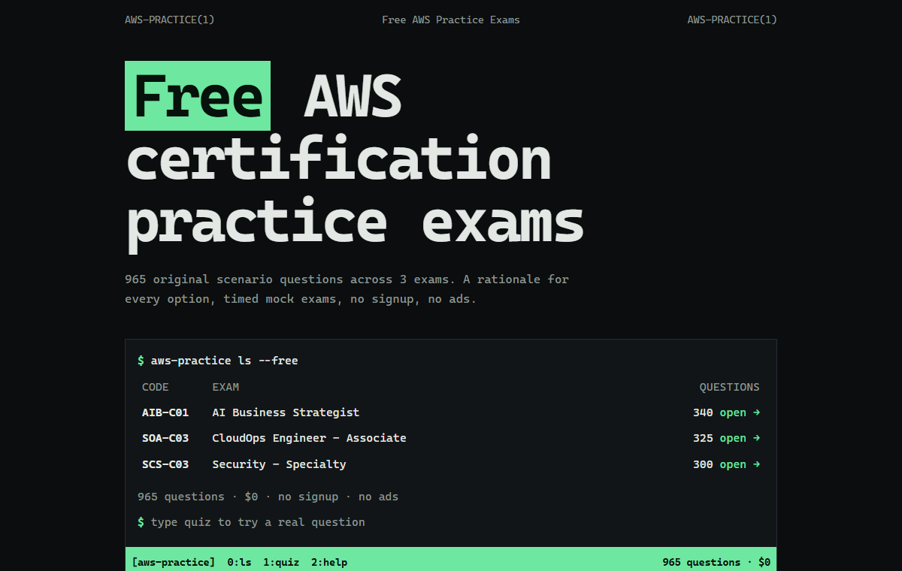

<div align="center">

# AWS Certified Practice Exams

Free practice questions and timed mock exams for **AWS certification** exams.<br>
965 original scenario questions across 3 exams, a rationale for every option, no signup, no ads.

**[Start practicing](https://zghanw.github.io/aws-certified-practice-exams/)** · [AIB-C01](https://zghanw.github.io/aws-ai-business-strategist/) · [SOA-C03](https://zghanw.github.io/aws-cloudops-engineer-associate/) · [SCS-C03](https://zghanw.github.io/aws-security-specialty/)

<a href="https://zghanw.github.io/aws-certified-practice-exams/"></a>
<a href="https://github.com/zghanw/aws-certified-practice-exams/commits/main"></a>
<a href="LICENSE"></a>

<br><br>



</div>

## Why this exists

Each exam has its own practice site and its own repository. This is the home page that lists them all, so a candidate who finds one can find the others.

## What's inside

| Exam | Questions | Mock exam | Practice | Source |
|---|---:|---|---|---|
| AWS Certified AI Business Strategist (AIB-C01) | 340 | 85 questions, 170 min | [Start](https://zghanw.github.io/aws-ai-business-strategist/) | [Repo](https://github.com/zghanw/aws-ai-business-strategist) |
| AWS Certified CloudOps Engineer - Associate (SOA-C03) | 325 | 65 questions, 130 min | [Start](https://zghanw.github.io/aws-cloudops-engineer-associate/) | [Repo](https://github.com/zghanw/aws-cloudops-engineer-associate) |
| AWS Certified Security - Specialty (SCS-C03) | 300 | 65 questions, 170 min | [Start](https://zghanw.github.io/aws-security-specialty/) | [Repo](https://github.com/zghanw/aws-security-specialty) |

- Practice one domain at a time. After each answer, every option shows why it's right or wrong.
- Take a mock exam with the question count and time limit from the official exam guide.
- Review each result with your answer and the correct answer labeled.
- Come back to the questions you missed. They're saved in your browser.
- Use it on a phone or a laptop.

The home page itself is a small terminal. Type `quiz` to try one real question from any exam.

## How the questions are written

Every question is original and written against the public AWS exam guides. None come from the real exam, paid courses, or dumps. Each one has a short scenario, a clear requirement, and options of similar length where every wrong answer is plausible and fails one requirement.

The questions were drafted with AI help, then checked one by one against the exam guide and AWS documentation.

Think a question is wrong? Open an issue on that exam's repository, linked in the table above, with the question ID shown above each question. You don't need to write any code.

## Run it locally

It's a static site with no build step and no dependencies.

```sh
git clone https://github.com/zghanw/aws-certified-practice-exams.git
cd aws-certified-practice-exams
python -m http.server 8000
```

Then open http://localhost:8000.

## Contributing

The questions live in each exam's own repository, and that is where to suggest a question or report a wrong one. This repository holds only the home page. `questions.js` has one sample question per exam for the `quiz` command.

If this helped you prepare, a star helps other candidates find it.

## Disclaimer

This is an unofficial study aid, not affiliated with or endorsed by Amazon Web Services. AWS and AWS Certified are trademarks of Amazon.com, Inc. or its affiliates.

## License

[MIT](LICENSE)
